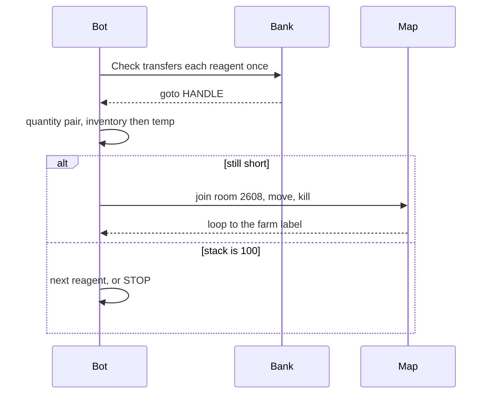
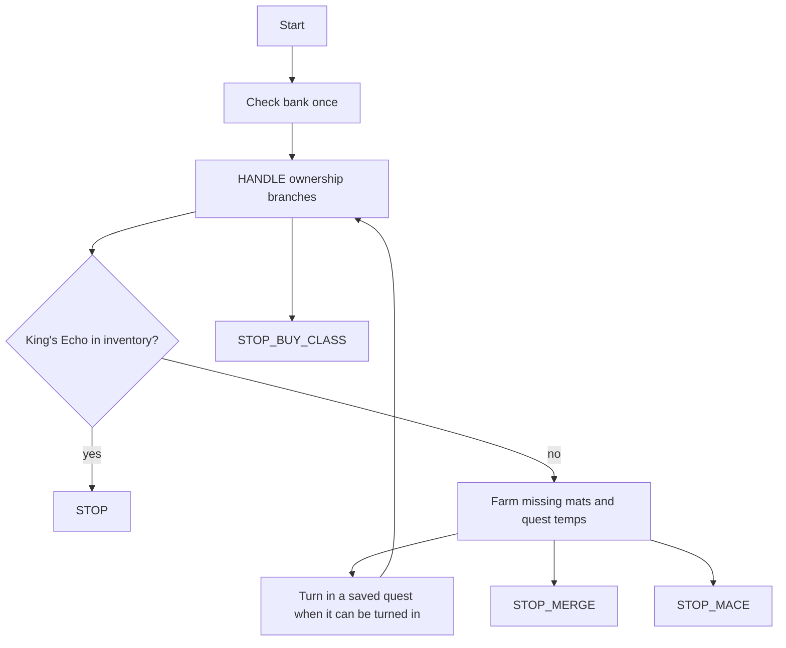
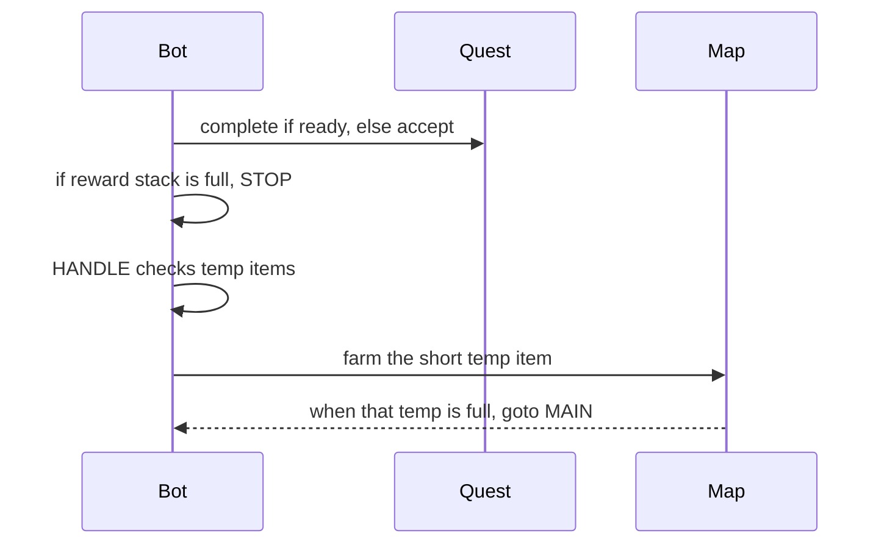

# Core Flows

> These flows are read from the `.gbot` files. They are not a wiki research note. Cells and quest IDs stay in the files. Do not copy them into a different bot from this page.

## Flow list

| Priority | Flow | Entry point | Evidence |
| --- | --- | --- | --- |
| P0 | Alchemy stack farm | `CmdGotoLabel Check` at the start of each Alchemy file | `Alchemy/Potion-Revitalize.gbot` |
| P0 | King's Echo staged farm | `MAIN` to `HANDLE`, with ownership branches and three manual stops | `Full/Kings-Echo.gbot` |
| P1 | Adeptus quest loop | `MAIN`, then `HANDLE`, then a farm label | `Adeptus Kathooli/Dark Elf Pearl.gbot` |

## Flow: Alchemy stack farm

### Call chain

1. Start delay, then `goto Check`. `MAIN` also goes to `Check`.
2. `Check` — `CmdInBank` then `CmdBankTransfer` for each reagent, then `goto HANDLE`.
3. `HANDLE` — for each reagent, `CmdNotInInventory` at `"100"`, goto `T_*`, else goto `A_*`.
4. `T_*` — `CmdNotInTemp` at `"100"`. If short, goto the farm label.
5. Farm label — pick up the drop, repeat the pair, kill, goto the farm label.
6. When every `A_*` is reached, goto `STOP`. The stop beeps and tells the user to mix, bank, and rerun.

### Key branches

- The bot does not open the Alchemy UI and does not mix.
- Stop text in every Alchemy file says the wiki mixes are guesswork.
- A kill does not return to `Check`.

## Flow: King's Echo

### Call chain

1. `HANDLE` checks whether the class and the intermediate items are already owned. Labels include `HaveReforged`, `HaveCrown`, `HaveSword`, `NeedLiberation`, `Shard80`, and `Orn60`.
2. Missing reagents use the quantity pair. Farm labels are `Farm*` / `Still*` / `Kill*`. Kills loop to the farm label.
3. Saved quests are accepted when not in progress and completed only when `CmdQuestCompleted` is true. Turn-in labels include `DoTurnInEcho`, `DoTurnInArmor`, `DoTurnInCrown`, `DoTurnInSword`, `DoTurnInHeimkehr`, `DoTurnInAnjou`, and `DoTurnInLilies`.
4. `AcceptDefiled` accepts quest ID `9369` and does not complete it.
5. Stops that must remain unless the user says otherwise:
   - `STOP` — King's Echo is already in inventory.
   - `STOP_BUY_CLASS` — turn in Echo of the King, then buy the class.
   - `STOP_MACE` — buy Alden's Mace. The bot does not buy it.
   - `STOP_MERGE` — merge at Bocklin. The bot does not merge.

### Key branches

- Owning an intermediate armor changes which quantity label runs. Read the file before changing a quantity. Do not copy a quantity from an old example or from these docs.
- After a turn-in, the file returns to that stage. It does not send every kill back to `Check`.
- Gold vouchers and the mace are not drop farms.

## Flow: Adeptus quest loop

### Call chain

1. Start goes to `MAIN` (`Main` in `Water Elf Antler.gbot`).
2. If the reward item is in inventory at the stop quantity, goto `STOP`.
3. Complete the quest if it can be turned in. Accept it if it is not in progress.
4. Pick up the reward drop, then goto `HANDLE`.
5. `HANDLE` uses `CmdNotInTemp` and a single goto to the farm label. This is not the Alchemy quantity pair.
6. The farm label uses `CmdInTemp` at the required quantity, then goto `MAIN`, else join, move, kill, and goto itself.

### Key branches

- Several Adeptus kills use `Monster` `*` while `CmdMonsterInRoom` names a specific monster. That is what the file contains. Do not "correct" it unless the user asks.
- `Sun Zone Chit.gbot` stops on `Sundered Tentacle` 200, not on Sun Zone Chit. Treat that as a known mismatch, not as the intended stop, and do not silently change it.
- `Water Elf Antler.gbot` gotos `MAIN`, `SCAVENGERFOAM`, and `ADIPOCEREANTLER` do not match the labels `Main`, `ScavengerFoam`, and `AdipocereAntler`.
- `Sundered Tentacle.gbot` has a `CmdQuestlist` with an empty `QuestID` after a goto, so that command is not on the live path. The live quest ID in that file is `9269`.

## Evidence

- `Alchemy/Potion-Revitalize.gbot`
- `Full/Kings-Echo.gbot` labels and the four stop messages
- `Adeptus Kathooli/Dark Elf Pearl.gbot`, `Sun Zone Chit.gbot`, `Sundered Tentacle.gbot`, `Water Elf Antler.gbot`
