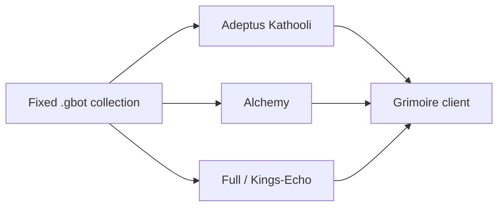

# Project Structure

## Directory tree

```text
Fixed/
├── README.md
├── AI_README.md
├── LICENSE
├── Adeptus Kathooli/
│   ├── Dark Elf Pearl.gbot
│   ├── Sun Zone Chit.gbot
│   ├── Sundered Tentacle.gbot
│   ├── Sur-gion Token.gbot
│   ├── Water Elf Antler.gbot
│   └── Water Elf Pearl.gbot
├── Alchemy/
│   ├── Potion-Battle-Divine.gbot
│   ├── Potion-Malevolence.gbot
│   ├── Potion-Potent-Barrier.gbot
│   ├── Potion-Potent-Battle.gbot
│   ├── Potion-Revitalize.gbot
│   ├── Potion-Sage-Soul.gbot
│   └── Potion-Tonics.gbot
├── Full/
│   └── Kings-Echo.gbot
└── docs/ai-readme/
```

There is no `src/`, no package manifest, and no test directory.

## Module responsibilities

| Path | Responsibility | Key files |
| --- | --- | --- |
| `Adeptus Kathooli/` | Repeat one quest until a reagent stack is in inventory | 6 `.gbot` files, about 54–65 commands each |
| `Alchemy/` | Pull reagents from the bank once, farm each stack to 100, stop for a manual mix | 7 `.gbot` files, about 69–127 commands each |
| `Full/` | King's Echo: ownership branches, nested armor mats, saved quest turn-ins, three manual stops | `Kings-Echo.gbot`, 896 commands, 152 labels |
| `docs/ai-readme/` | Facts for the next agent | see `AI_README.md` |

## File catalog

Quest IDs below are already stored in that file. They are not a source for a new bot. Names were matched from the `grimoire-aqw-bot` known-quests list to those IDs while these docs were written. If that list is unavailable, the ID in the file is the only ID that file is allowed to keep.

### Adeptus Kathooli

| File | Quest already in the file | Inventory stop in the file | Map already in the file |
| --- | --- | --- | --- |
| `Dark Elf Pearl.gbot` | 9339, Undine's Dredge | Dark Elf Pearl 30 | `trenchobserve`, room 2608 |
| `Sun Zone Chit.gbot` | 9252, Suckers for Supper | Sundered Tentacle 200, not Sun Zone Chit | `sunlightzone`, room 2608 |
| `Sundered Tentacle.gbot` | 9269, Belly-Up | Sundered Tentacle 100 | `twilightzone`, room 2608 |
| `Sur-gion Token.gbot` | 9235, Kalamari Kontamination | Sur-gion Token 50 | `ashray`, room 2608 |
| `Water Elf Antler.gbot` | 9316, Burial at Sea | Water Elf Antler 200 | `abyssalzone`, room `1` |
| `Water Elf Pearl.gbot` | 9302, Sparagmos Andromeda | Water Elf Pearl 40 | `midnightzone`, room 2608 |

`Sun Zone Chit.gbot` is the only Adeptus file with a `Check` label. That label is not reached from the start. See lessons learned.

### Alchemy

Each file farms the named reagents to 100 in private room `2608`, then stops. The stop message names a mix and says the wiki mixes are guesswork. The bot does not mix.

| File | Reagents already checked in the file | Maps already in the file |
| --- | --- | --- |
| `Potion-Battle-Divine.gbot` | Dragon Scale (1), Rhison Blood, Chaoroot | `lair`, `bloodtusk`, `roc` |
| `Potion-Malevolence.gbot` | Doomatter, Dried Slime, Nimblestem | `maul`, `mudluk` |
| `Potion-Potent-Barrier.gbot` | Roc Tongue, Chaoroot | `mountainpath`, `roc` |
| `Potion-Potent-Battle.gbot` | Doomatter, Nimblestem | `maul`, `mudluk` |
| `Potion-Revitalize.gbot` | Lemurphant Tears, Arashtite Ore | `crossroads`, `orecavern` |
| `Potion-Sage-Soul.gbot` | Arashtite Ore, Dragon Scale (1) | `orecavern`, `lair` |
| `Potion-Tonics.gbot` | Dried Slime, Trollola Nectar, Roc Tongue, Chaoroot | `maul`, `bloodtusk`, `mountainpath`, `roc` |

Item names are exact, including `Dragon Scale (1)` and apostrophes such as `Noelle's Brooch`.

### Full

`Full/Kings-Echo.gbot` already contains these quest IDs:

| ID already in the file | Name matched while documenting | What the file does with it |
| --- | --- | --- |
| 10439 | Echo of the King | accept and turn in |
| 10440 | Purify The Crown | accept and turn in |
| 10441 | The King's Armor | accept and turn in |
| 10442 | The Path of the King | accept and turn in |
| 10240 | Die Heimkehr - The Return | accept and turn in |
| 10253 | Anjou Fleur | accept and turn in |
| 10266 | Rootless Lilies | accept and turn in |
| 9369 | Defiled Destiny | accept and quest-list only. No complete command |

Manual stops already in the file: class is owned; buy King's Echo after Echo of the King; buy Alden's Mace; merge at Bocklin. Do not remove those stops unless the user asks.

## Dependencies between modules

The folders do not import each other. Shared drop sources are duplicated on purpose. Do not refactor two files to share a cell or a quest ID.



## Evidence

- `.gbot` files under `Adeptus Kathooli/`, `Alchemy/`, and `Full/`
- `README.md`, `LICENSE`
- `grimoire-aqw-bot` skill rules used only to name IDs already present in the files
