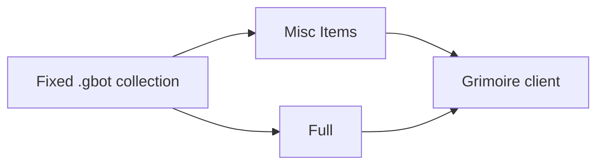

# Project Structure

## Directory tree

```text
Fixed/
├── README.md
├── AI_README.md
├── LICENSE
├── Misc Items/
│   └── *.gbot
├── Full/
│   └── *.gbot
└── docs/ai-readme/
```

There is no `src/`, no package manifest, and no test directory.

## Module responsibilities

| Path | Responsibility | Typical size |
| --- | --- | --- |
| `Misc Items/` | Quest turn-in farms for miscellaneous reagents (formerly Adeptus Kathooli) | ~54–65 commands each |
| `Full/` | Class farms: ownership branches, nested armor mats, saved quest turn-ins, manual stops | ~896 commands, ~152 labels (Kings-Echo); Scion-of-Flames varies |
| `docs/ai-readme/` | Facts for the next agent | see `AI_README.md` |

## File inventory (as of documentation pass)

Quest IDs below are already stored in that file. They are not a source for a new bot. If the known-quests list is unavailable, the ID in the file is the only ID that file is allowed to keep.

### Misc Items (example entries)

| File | Quest already in the file | Inventory stop in the file | Map already in the file |
| --- | --- | --- | --- |
| `Dark Elf Pearl.gbot` | 9339, Undine's Dredge | Dark Elf Pearl 30 | `trenchobserve`, room 2608 |
| `Sun Zone Chit.gbot` | 9252, Suckers for Supper | Sundered Tentacle 200 | `sunlightzone`, room 2608 |
| `Sundered Tentacle.gbot` | 9269, Belly-Up | Sundered Tentacle 100 | `twilightzone`, room 2608 |
| `Sur-gion Token.gbot` | 9235, Kalamari Kontamination | Sur-gion Token 50 | `ashray`, room 2608 |
| `Water Elf Antler.gbot` | 9316, Burial at Sea | Water Elf Antler 200 | `abyssalzone`, room `1` |
| `Water Elf Pearl.gbot` | 9302, Sparagmos Andromeda | Water Elf Pearl 40 | `midnightzone`, room 2608 |
| `Silver-Stake.gbot` | (check file) | (check file) | (check file) |

> **Note:** This table reflects the files present when these docs were written. New Misc Items files added later will not appear here — check the directory directly.

`Sun Zone Chit.gbot` is the only Misc Items file with a `Check` label. That label is not reached from the start. See lessons learned.

### Full (example entries)

`Full/Kings-Echo.gbot` already contains these quest IDs:

| ID already in the file | Name matched while documenting | What the file does with it |
| --- | --- | --- |
| 10439 | Echo of the King | accept and turn in |
| 10440 | Purify The Crown | accept and turn in |
| 10441 | The King's Armor | accept and turn in |
| 10442 | The Path of the King | accept and turn in |
| 10240 | Die Heimkehr - The Return | accept and turn in |
| 10253 | Anjou Fleur | accept and turn in |
| 10266 | Rootless Lilies | accept and turn in |
| 9369 | Defiled Destiny | accept and quest-list only. No complete command |

Manual stops already in the file: class is owned; buy King's Echo after Echo of the King; buy Alden's Mace; merge at Bocklin. Do not remove those stops unless the user asks.

`Full/Scion-of-Flames.gbot` — contents to be documented when reviewed.

## Dependencies between modules

The folders do not import each other. Shared drop sources are duplicated on purpose. Do not refactor two files to share a cell or a quest ID.



## Evidence

- `.gbot` files under `Misc Items/` and `Full/`
- `README.md`, `LICENSE`
- `grimoire-aqw-bot` skill rules used only to name IDs already present in the files