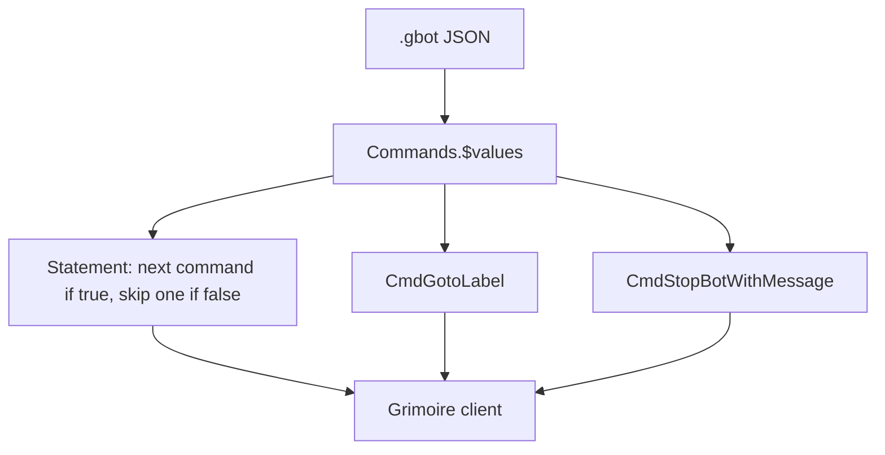

# Technical Architecture

## Architecture overview

A `.gbot` file is one JSON document. Grimoire walks `Commands.$values` from the top. There is no runtime in this repo.



Root shape, from the files:

```json
{
  "$type": "Grimoire.Botting.Configuration, Grimoire",
  "Commands": {
    "$type": "System.Collections.Generic.List`1[[Grimoire.Botting.IBotCommand, Grimoire]], mscorlib",
    "$values": []
  }
}
```

Keep those `$type` strings. Do not rename fields. Do not pretty-print a whole file with a fresh JSON dump when a smaller edit will do.

## Flow model

Taken from the `grimoire-aqw-bot` validator, and matched against these files:

- A statement (`CmdInInventory`, `CmdNotInTemp`, `CmdQuestCompleted`, and the other `Statements.*` commands) runs the next command when true and skips it when false.
- An `If` applies only to the immediately following command. A label immediately after a statement is a no-op branch.
- `CmdGotoLabel` jumps to `CmdLabel` with the same `Name`. Matching is exact. `Main` is not `MAIN`.
- `CmdStopBotWithMessage` ends the run.
- Anything else falls through.

## Two layouts in this repo

### Quantity pair

Used by `Full/Kings-Echo.gbot`. (The former `Alchemy/` files used this layout; they are no longer in this tree.)

```text
CmdNotInInventory  item, required quantity
goto T_<item>
goto A_<item>

label T_<item>
CmdNotInTemp  item, same quantity
goto Farm<item>

label A_<item>
next check, turn-in, or STOP
```

The two gotos must not share a label. If they do, the bot cannot see that it already has enough and farms forever.

A farm label repeats that pair (`Still` / kill / after). The kill loops to the farm label, not to `Check`. `Check` transfers from the bank once, then goes to `HANDLE`.

### Misc Items turn-in loop

Used by `Misc Items/`. This is not the quantity-pair layout. Do not convert it unless the user asks.

```text
label MAIN
if reward is in inventory at the stop quantity: goto STOP
if quest can be turned in: complete it
if quest is not in progress: accept it
pick up the reward if it dropped
goto HANDLE

label HANDLE
if a temp item is short: goto that farm label
fall through toward the next temp, then back toward MAIN from the farm

label Farm
if temp already has the quantity: goto MAIN
join, move, kill
goto Farm
```

Most of these files have no `Check` label. `Sun Zone Chit.gbot` has one, and the start jumps over it. `Water Elf Antler.gbot` uses `Main`, not `MAIN`, and some later gotos do not match the label text.

## Layers

| Layer | Responsibility | Main files |
| --- | --- | --- |
| Collection | Reviewed bots only | this repo |
| Bot JSON | Commands, labels, item names, cells, quest IDs already saved in that file | `*.gbot` |
| Client | Runs the file | Grimoire / grimoire-exodus, not in this repo |
| Agent knowledge | Cell list, quest-ID list, validator | `grimoire-aqw-bot` and `aqw-quest-id` skills, not in this repo |

## Technology stack

| Category | Technology | Version/source | Purpose |
| --- | --- | --- | --- |
| Language/runtime | JSON | Grimoire command list | Bot definition |
| Framework | Grimoire | `$type` strings in each file | Client that executes commands |
| Build tool | none | no manifest in this repo | |
| Test framework | none in this repo | `validate_gbot.py` lives with the `grimoire-aqw-bot` skill | Structure and flow check, not an in-game test |

## Evidence

- `Full/Kings-Echo.gbot` for the quantity pair, `Check`, and farm loop
- `Misc Items/Dark Elf Pearl.gbot` for the Misc Items turn-in loop
- `Full/Kings-Echo.gbot` labels `HANDLE`, `Check`, `T_*`, `A_*`, `STOP_BUY_CLASS`, `STOP_MACE`, `STOP_MERGE`
- `grimoire-aqw-bot` references `gbot-structure.md` and `common-patterns.md` for the intended pair. Those references are not in this repo.
